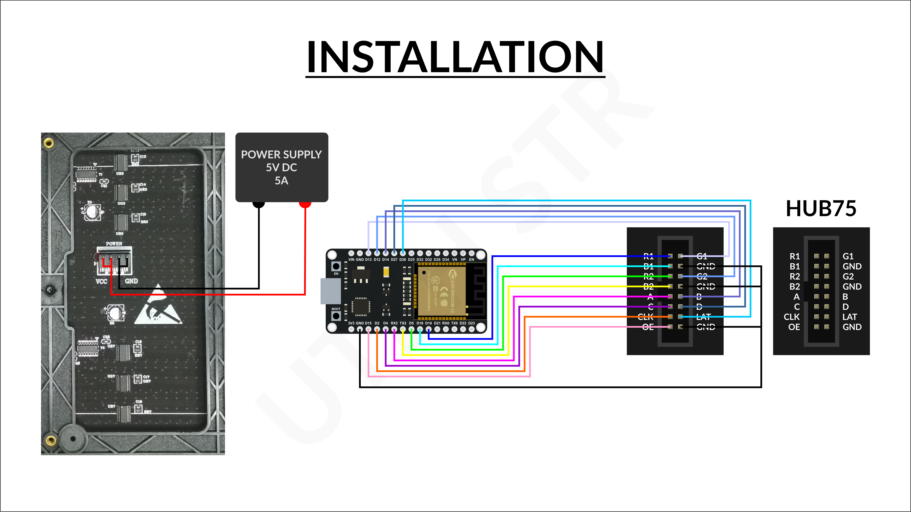
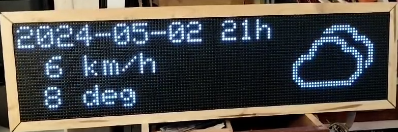
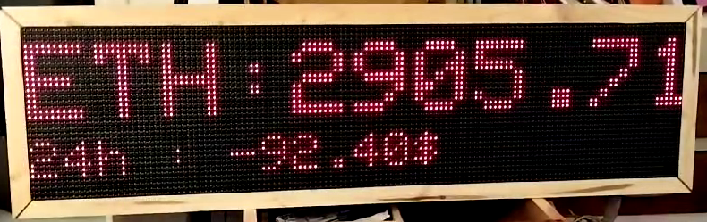
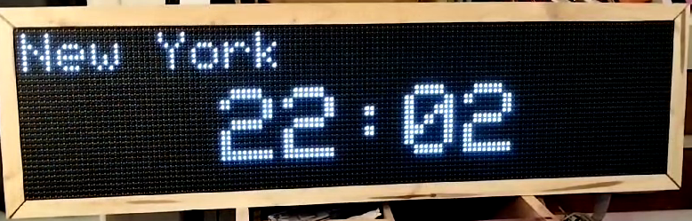
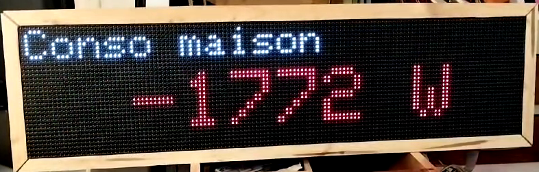

# ESP32 LED PANEL

Panneaux d'affichage connecté permettant la récupération et l'affichage déroulant de données custom comme par exemple :

- cours de cryptomonnaies (API www.livecoinwatch.com)

- heure sur differents fuseaux

- production solaire et consommation électrique de la maison (API locale `GET /api/homestatus`)

- couleur EDF Tempo (API https://www.api-couleur-tempo.fr)

- Prévision météo (API www.openweathermap.org)

Il va falloir 

 - un ESP32 pour se connecter au réseau et récupérer les infos
<https://fr.aliexpress.com/item/1005006422498371.html>

 - des panneaux led P5
<https://fr.aliexpress.com/item/32760855293.html>
 
Pour le cablage :

Voila ce que ca peut donner, à vous de modifier !

Pensez à modifier `credentials.h` avec votre SSID, mot de passe Wi-Fi et vos clés API météo/crypto.

Les données solaires et de consommation sont récupérées depuis le service centralisé à
`http://192.168.1.168:8787/api/homestatus`. Le panneau ne contacte plus directement
Solax. Pour changer l’adresse, modifiez `homeStatusUrl` dans `credentials.h`.

### Mise à jour sans fil (OTA)

Après un premier téléversement par USB et une connexion au Wi-Fi, l'ESP32 annonce
`esp32-led-panel` sur le réseau. Dans Arduino IDE, sélectionnez ce port réseau depuis
le menu des ports, puis téléversez le programme comme d'habitude. L'ordinateur et
l'ESP32 doivent être sur le même réseau local.

Le mot de passe OTA est défini par `otaPassword` dans `credentials.h`. Gardez ce
secret dans votre fichier local et ne le publiez pas dans le dépôt.

sources:

<https://www.youtube.com/watch?v=KuOBKi-yVoc&t=408s>
<https://github.com/mrcodetastic/ESP32-HUB75-MatrixPanel-DMA/blob/master/examples/BitmapIcons/BitmapIcons.ino>
